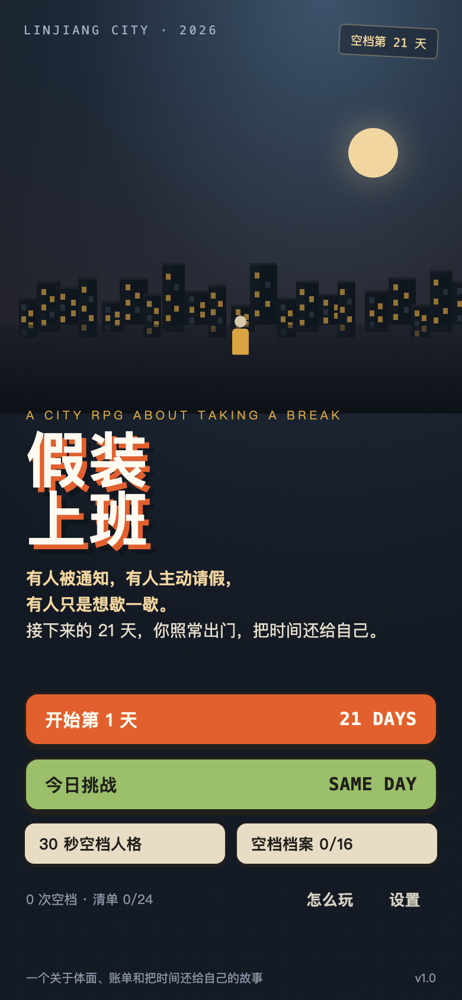
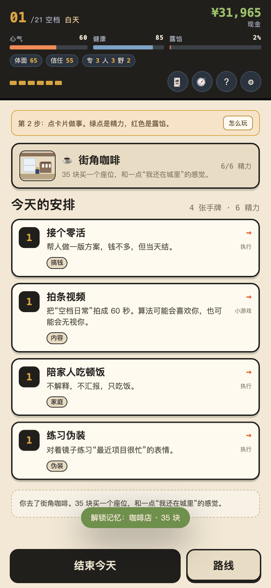
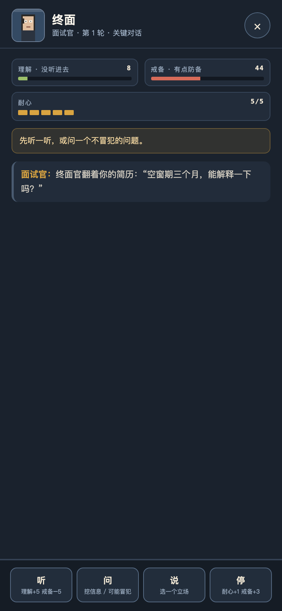
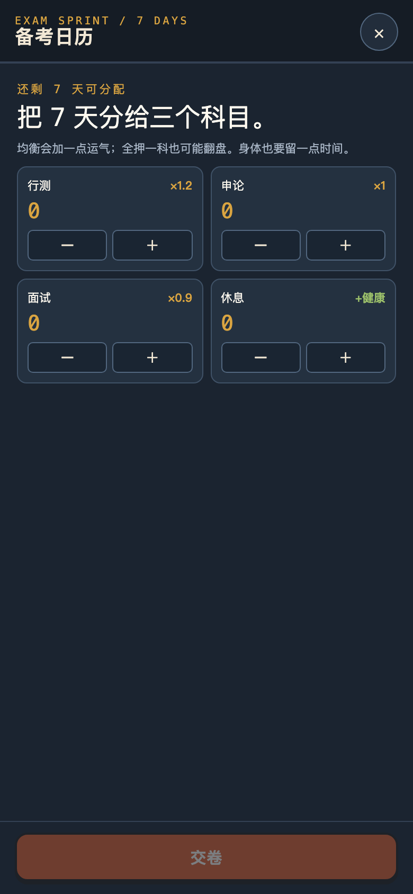
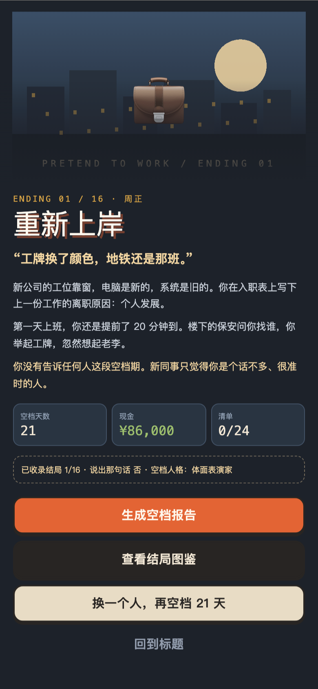
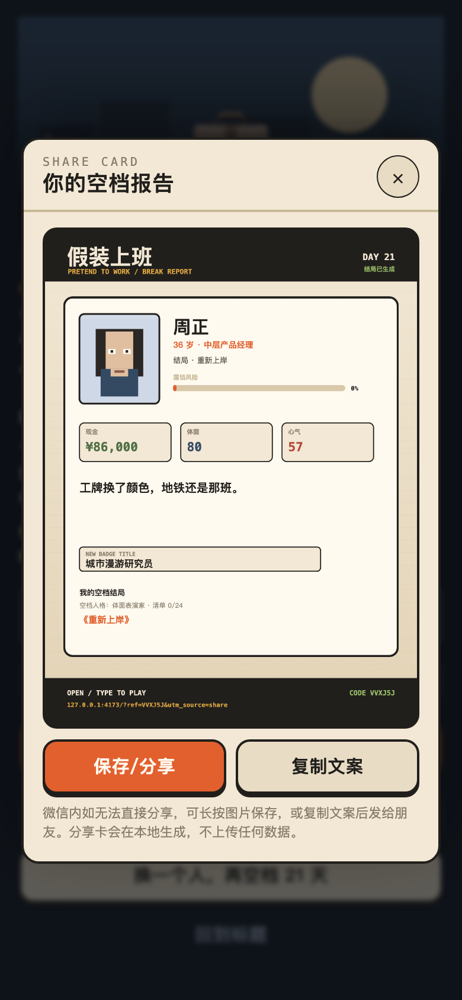

# 假装上班 · Pretend to Work

> 有人被通知，有人主动请假，有人只是想歇一歇。  
> 接下来的 21 天，你照常出门，把时间还给自己。

一款手机优先的中文城市叙事 RPG。**不是只有被裁的人**：主动请假、裸辞、项目空档、照护家人、长期上班后想短休的人，都可以进入 21 天空档期。9 个可选主角、12 条路线、16 个结局。没有战斗，只有账单、体面、露馅值，和一场场必须谈下去的关键对话。




| 关键对话 | 小游戏 | 结局 | 分享卡 |
| --- | --- | --- | --- |
|  |  |  |  |

## 立即开始

**最省事：双击根目录的 [`假装上班.html`](./假装上班.html)。**

这是一个完全自包含的单文件版本，CSS、脚本、档案都在里面，不联网、不安装，存档在浏览器 localStorage。

**开发模式：**

```bash
npm install --cache ./.npm-cache   # 本项目所在环境的 npm 默认缓存目录无写权限
npm run dev                        # http://127.0.0.1:4173
```

**构建单文件：**

```bash
npm run build
# 输出 dist/index.html 与 假装上班.html
```

**跑测试：**

```bash
npm test
```

当前 21 项核心逻辑/内容测试全部通过。

## 你会玩到什么

- **一句暂停**：HR 通知、主动请假、项目轮休、照护假，都从“明天不用去公司”开始。你可以一直假装还在上班，也可以在 4 个时刻说出那句话。
- **9 个主角**：有人被通知，有人主动请无薪假、合同到期不续、工厂轮休、请长假照护家人，也有人只是想从长期通勤里停一下。每个人的账单和软肋都不同。
- **12 条路线**：再就业、考公考编、回前公司、内容创作、自由职业/AI 接单、摆摊、开店、灵活就业、跨境、慢生活/返乡、全职家庭、伪装大师。
- **16 个结局**：12 个路线结局 + 第二种自由、说出口、半途、崩盘。
- **关键对话**：没有 HP 和攻击。听、问、说、停；理解、戒备、耐心；16 张底牌。谈成、缓和或谈崩。
- **5 个小游戏**：家庭盘问、爆款制造机、生意账本、跑单节奏、备考日历。
- **24 项第二人生清单**、12 段通勤记忆、3 份周报、40 条手机动态。
- **分享与裂变**：空档报告海报、空档人格测试、每日同种子挑战、内推码、周报分享。
- **低文字负担**：首日 4 步教练、随时可开的“怎么玩”、卡面只留关键信息、手机动态默认折叠。

## 操作

- 手机触屏：点按卡片和按钮。
- 桌面：`1–5` 打出手牌，`Enter` 结束当天，`Esc` 关闭弹窗。
- 所有进度自动保存；“继续空档”从上次阶段恢复。

## 技术结构

```text
├─ index.html / styles/main.css
├─ src/
│  ├─ core/        # rng、状态、检定、经济、对话、小游戏、结局、存档
│  ├─ data/        # 9 角色、12 路线、16 结局、40 卡、17 对话、30 事件……
│  └─ ui/          # 页面、像素美术、音频、分享卡
├─ tests/          # node --test
├─ scripts/        # dev server、单文件构建
├─ docs/GAME_DESIGN.md
├─ screenshots/
└─ dist/           # 构建产物
```

- 无运行时依赖；esbuild 只用于构建。
- 单文件构建把 CSS/JS 内联进 HTML，`file://` 直接可玩。
- 所有美术由 CSS/SVG/Canvas 代码生成，无外部图片或字体请求。
- 分享 URL 参数：`?ref=CODE`（内推）、`?seed=YYYY-MM-DD&persona=xxx`（每日挑战）、`?utm_source=share`。
- 存档键：`pretendWork.save.v1`、`pretendWork.meta.v1`、`pretendWork.settings.v1`。

## 分享与部署

- 分享卡在本地 Canvas 生成，不上传任何数据。
- 支持 `navigator.share` 带图片；不支持时下载 PNG + 复制文案。
- 将 `dist/` 部署到任意静态托管即可（GitHub Pages / Cloudflare Pages / Netlify）。微信内分享建议配置已备案域名，并在 P1 加二维码/JS-SDK 适配。
- 每日挑战与内推目前是客户端实现，不做虚假的全球排行榜；真实邀请归因需 P1 接服务端。

## 设计文档

完整的世界观、系统、数值、9 角色、12 路线、16 结局、裂变与路线图见 [`docs/GAME_DESIGN.md`](./docs/GAME_DESIGN.md)。

## 免责声明

本作所有公司、人物、城市、赔偿细节均为虚构，不构成任何劳动法、投资或心理建议。如果你正在经历失业、负债、家庭压力或情绪困扰，请向身边的人或专业机构求助。你不是一个人。
